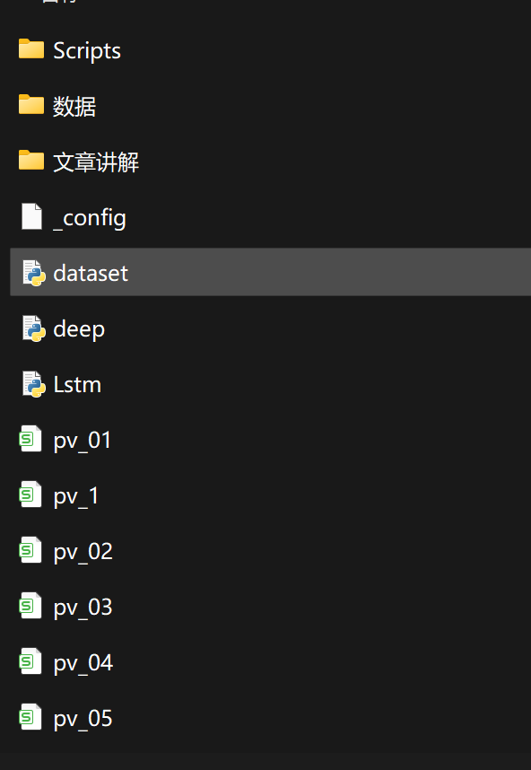

# Solar Power Generation Forecast Based on LSTM (Python Code + Data + Article Explanation)

The prediction of solar power generation based on LSTM (Python code + data + article explanation)
The prediction of electricity generation from renewable power plants is an active research area, as reliable information about future power generation can ensure grid safety and help minimize operational costs for these energy sources. Deep learning algorithms have proven to be very powerful in prediction tasks, such as economic time series or speech recognition. So far, deep learning algorithms have been rarely used for predicting renewable energy power plants. By employing different deep learning and artificial neural network algorithms, such as LSTM, we introduce these powerful algorithms into the field of renewable energy power prediction. Our motivation is to demonstrate the predictive strength of these algorithms compared to standard MLP and physical prediction models when predicting the energy output of 21 solar power plants, and to compare our results with those obtained by artificial neural networks and other reference models (such as physical models).

## Images

<!-- PAYMENT_BLOCK -->

## Get this dataset

- Payment link (Stripe): [Buy now](https://buy.stripe.com/3cs8yP7sY87d0vu9AB)
- Payment QR code: 

<!-- /PAYMENT_BLOCK -->
